# Rewamp — AI-Powered Book Exploration & Grounded RAG Platform

> An intelligent, full-stack literary exploration platform combining high-fidelity PDF reading with conversational, retrieval-augmented question answering grounded strictly in book texts.

---

## Table of Contents

- [Project Overview](#project-overview)
- [Key Capabilities](#key-capabilities)
- [Technology Stack](#technology-stack)
- [Architecture](#architecture)
  - [System Flow & Workflow Diagram](#system-flow--workflow-diagram)
  - [Frontend Architecture](#frontend-architecture)
  - [Backend Architecture](#backend-architecture)
- [Project Structure](#project-structure)
- [Prerequisites](#prerequisites)
- [Installation and Setup](#installation-and-setup)
- [Running Locally](#running-locally)
- [Environment Variables](#environment-variables)
- [The RAG Pipeline](#the-rag-pipeline)
  - [1. Extraction & Document Inspection](#1-extraction--document-inspection)
  - [2. Token-Aware Chunking](#2-token-aware-chunking)
  - [3. Dense Vector Embeddings](#3-dense-vector-embeddings)
  - [4. Qdrant Cloud Vector Indexing](#4-qdrant-cloud-vector-indexing)
  - [5. Intent-Aware Retrieval & Query Expansion](#5-intent-aware-retrieval--query-expansion)
  - [6. Candidate Deduplication & Hybrid Rescoring](#6-candidate-deduplication--hybrid-rescoring)
  - [7. Evidence Sufficiency Evaluation](#7-evidence-sufficiency-evaluation)
  - [8. Groq LLM Answer Generation](#8-groq-llm-answer-generation)
  - [9. Citation Validation & Strict Non-Fabrication](#9-citation-validation--strict-non-fabrication)
  - [10. In-Memory Query Caching](#10-in-memory-query-caching)
- [Book Ingestion and Management](#book-ingestion-and-management)
- [API Reference](#api-reference)
- [Testing and Build](#testing-and-build)
- [Troubleshooting](#troubleshooting)
- [Security and Data Storage](#security-and-data-storage)
- [Limitations, Contributing, and License](#limitations-contributing-and-license)

---

## Project Overview

**Rewamp** is a full-stack, AI-powered reading and research application designed to bridge the gap between classic literature reading and factual, hallucination-free AI assistance. Built with a **React 19 / TypeScript** frontend and a **FastAPI** backend, Rewamp allows readers to browse a digital library, stream and read PDF documents through an interactive reader, and converse with an AI companion that answers questions strictly derived from the selected book's text.

Unlike generic chat systems that suffer from LLM hallucinations or cross-document confusion, Rewamp implements **isolated book-level retrieval**, **multi-angle intent expansion**, **hybrid semantic-lexical reranking**, and **evaluative evidence-sufficiency gates**. If a book does not contain the answer, Rewamp gracefully explains that the text lacks the necessary information rather than fabricating details. Every valid answer includes verifiable citation cards that link directly into the embedded PDF reader at the exact referenced page.

---

## Key Capabilities

- **Interactive In-Browser PDF Reader**: Full-screen PDF reading powered by React-PDF and PDF.js with zooming, fit-to-width, multi-page navigation, and dark/light/system theme adaptation.
- **Strict Single-Book Isolation**: Vector search queries are strictly scoped to the active `book_id` and active index version, preventing cross-book contamination.
- **Intent-Aware Query Expansion**: Automatically classifies questions as *Specific Factual* or *Broad Synthesis* (e.g., turning points, themes, conflicts, character arcs) and generates diversified query formulations.
- **Hybrid Semantic & Lexical Reranking**: Combines dense cosine similarity (75%) from 384-dimensional embeddings with lexical keyword matching (25%) and phrase proximity bonuses.
- **Cross-Narrative Candidate Deduplication**: Evaluates Jaccard overlap to eliminate redundant adjacent passages, ensuring broad questions cover diverse chapters and page regions.
- **Evidence-Sufficiency Gate**: Discards low-similarity noise and rejects questions containing entities unmentioned in the text before prompting the LLM.
- **Verifiable Citations with Direct Page Navigation**: Extracts referenced passages with start/end pages, chapter headers, excerpt text, and relevance scores. Clicking any citation opens the PDF reader directly at that page.
- **Zero-Downtime Versioned Ingestion**: Books are indexed using atomic version increments (`v1`, `v2`, ...). New points are verified before updating the active version, ensuring readers experience zero query downtime.
- **Crash-Resilient SQLite State Store**: Ingestion progress, active versions, SHA-256 file hashes, and configuration hashes are persisted in SQLite (WAL mode) and automatically recover upon restart.
- **Token Accounting & Real-Time Diagnostics**: Tracks actual prompt and completion tokens, context consumption, retrieval latencies, and generation times in a dedicated diagnostics inspection drawer.
- **Enchanted Fantasy Aesthetics**: Implements custom CSS styling featuring a 3D animated celestial astrolabe portal, floating book stage, and cinematic scene transitions.

---

## Technology Stack

| Layer | Technology | Version | Purpose / Verified Configuration |
| :--- | :--- | :--- | :--- |
| **Frontend Framework** | React | `^19.1.0` | Declarative UI rendering, hooks, and component lifecycle |
| **Language (Frontend)** | TypeScript | `^5.8.3` | Strict static typing across components, contracts, and APIs |
| **Bundler & Dev Server**| Vite | `^6.3.5` | Fast HMR dev server and production asset bundling |
| **Routing** | React Router DOM | `^7.6.3` | Client-side routing (`/`, `/library`, `/read/:bookId`, `/chat/:bookId`) |
| **PDF Rendering** | React-PDF & PDF.js | `^9.2.1` / `^4.10.38` | In-browser canvas/text layer rendering and PDF streaming |
| **Styling** | Vanilla CSS3 | Modern CSS | Design tokens, glassmorphism, 3D transforms, responsive layouts |
| **Frontend Testing** | Vitest & Testing Library | `^5.0.5` / `^16.3.3` | Unit, component, and theme testing with jsdom |
| **Backend Framework** | FastAPI | `>=0.100.0` | Asynchronous REST API, dependency injection, and Pydantic validation |
| **ASGI Web Server** | Uvicorn | `>=0.23.0` | Production ASGI web server with standard extras |
| **Language (Backend)** | Python | `>=3.10` | Backend runtime with typed schemas and asynchronous concurrency |
| **Document Processing**| PyMuPDF (`fitz`) | `>=2.0.0` | High-fidelity page extraction and JPEG cover rendering |
| **PDF Metadata** | PyPDF | `>=4.0.0` | PDF page count and embedded metadata extraction |
| **Embedding Model** | FastEmbed (`bge-small-en-v1.5`) | `>=0.4.0` | Local ONNX-accelerated dense embeddings (384 dims, Cosine distance) |
| **Vector Database** | Qdrant Cloud | `>=1.10.0` | Cloud-hosted vector database with payload indexing and filtering |
| **LLM Provider** | Groq Python SDK | `>=1.0.0` | Ultra-fast inference with fallback discovery (`qwen/qwen3.8-27b`) |
| **State Persistence** | SQLite3 | Built-in | WAL-mode persistent store for book states, hashes, and jobs |
| **Configuration** | Python-Dotenv | `>=1.0.0` | Safe environment variable loading from root `.env` |
| **Backend Testing** | Pytest & TestClient | Latest | Integration tests covering extraction, chunking, retrieval, and API |

---

## Architecture

### System Flow & Workflow Diagram

```mermaid
sequenceDiagram
    autonumber
    actor User as Reader / Client
    participant UI as React Frontend (Vite :5173)
    participant API as FastAPI Backend (:8000)
    participant DB as SQLite State Store (WAL)
    participant Ext as PyMuPDF / Chunker
    participant Emb as FastEmbed (BGE-Small)
    participant Qdrant as Qdrant Cloud Vector DB
    participant Groq as Groq LLM (Qwen 27B)

    %% Ingestion Flow
    rect rgb(20, 25, 35)
    Note over User, Qdrant: Ingestion Workflow (Zero-Downtime Versioned Indexing)
    User->>UI: Click "Ingest Book" or "Ingest All"
    UI->>API: POST /api/rag/ingest/{book_id}
    API->>DB: Check active job & compute SHA-256 hashes
    API-->>UI: 200 OK (job_id, status="started")
    API->>Ext: Extract pages from PDF & detect scanned docs
    Ext->>Ext: Token-aware chunking (384 target, 64 overlap, <=490 ceiling)
    API->>Emb: Batch embed chunk texts (384 dimensions)
    API->>Qdrant: Upsert versioned points (version = N+1)
    API->>Qdrant: Validate point count in collection
    API->>DB: Atomically activate version N+1 (status="ready")
    API->>Qdrant: Prune superseded versions (< N+1)
    end

    %% Query / Chat Flow
    rect rgb(25, 35, 25)
    Note over User, Groq: Question Answering & Retrieval Workflow
    User->>UI: Ask question about book
    UI->>API: POST /api/chat {book_id, question, top_k}
    API->>DB: Validate book readiness & retrieve active_version
    API->>API: Classify query intent (Specific vs. Broad Synthesis)
    API->>Emb: Embed question (and expansions if broad)
    API->>Qdrant: Vector search (filtered by book_id & active_version)
    Qdrant-->>API: Candidate chunks pool
    API->>API: Deduplicate chunks (Jaccard < 0.65) & Hybrid rescore
    API->>API: Evaluate evidence sufficiency (reject noise & unmentioned entities)
    alt Insufficient Evidence
        API-->>UI: Conversational refusal ("Book does not contain details...")
    else Sufficient Evidence
        API->>Groq: Generate grounded answer (strict context tokens budget)
        Groq-->>API: Raw answer with [Source N] references
        API->>API: Validate citations, sanitize formatting & clean prose
        API-->>UI: 200 OK {answer, citations, is_grounded, diagnostics}
        UI->>User: Render formatted answer & citation cards
    end
    end

    %% Citation Navigation Flow
    rect rgb(35, 25, 30)
    Note over User, UI: Citation Navigation
    User->>UI: Click citation card [Page 42]
    UI->>UI: Navigate to /read/{book_id}?page=42
    UI->>API: GET /api/books/{book_id}/pdf
    API-->>UI: Stream PDF binary
    UI->>User: Jump directly to Page 42 in PDF Reader
    end
```



### Frontend Architecture

The frontend is structured as a modern Single-Page Application (SPA):

- **Routes (`src/App.tsx`)**:
  - `/` (`LandingPage.tsx`): 3D cinematic library entrance scene with camera zoom transition.
  - `/library` (`LibraryPage.tsx`): Catalog view with search, filter, individual/bulk ingestion triggers, and 3D animated floating book background.
  - `/read/:bookId` (`ReaderPage.tsx`): PDF reader with pagination, zoom controls, fit-width mode, dark/light theme switching, and direct page navigation via URL query parameters (`?page=N`).
  - `/chat/:bookId` & `/chat` (`ChatPage.tsx`): Conversational RAG workspace featuring the illuminated *Central Knowledge Portal*, prompt starters, interactive citation cards, and a slide-out diagnostic inspection drawer.
- **Shared Components (`src/components/`)**:
  - `Nav.tsx`: Top navigation bar with route links and dark/light/system theme toggle.
  - `BookCard.tsx`: Physical hardcover 3D book visual with realistic spine ridge, deckled paper edges, dynamic palette generation, and ingestion status badges.
  - `CentralKnowledgePortal.tsx`: SVG celestial orbital astrolabe with animated constellation rings, illuminated book beam, and glowing pages.
  - `FloatingLibraryBackground.tsx`: Interactive canvas rendering floating open books with randomized orbital velocities and depth perspective.
  - `ChatMagicalBackground.tsx`: Ambient starry glow background for the chat workspace.
- **Context & State (`src/context/ThemeContext.tsx`)**:
  - Persistent theme management supporting `dark`, `light`, and `system` modes synchronized with `localStorage` and HTML class attributes.
- **API Client (`src/api/books.ts`)**:
  - Fully typed HTTP wrapper handling books catalog, cover streaming, ingestion polling, and chat requests.

### Backend Architecture

The backend is built as a modular FastAPI service:

- **FastAPI Core (`backend/main.py`)**:
  - Application entry point with CORS middleware configuration, lifespan pre-warming of cover thumbnails, and route grouping (`System`, `Books`, `Ingestion`, `Chat`).
- **RAG Subsystem (`backend/rag/`)**:
  - `config.py`: Centralized configuration loading settings from `.env`, with dynamic Groq model discovery and key validation.
  - `schemas.py`: Strongly typed Pydantic models for chat requests, citations, diagnostics, and ingestion progress contracts.
  - `extractor.py`: High-fidelity text extraction via PyMuPDF with blank/scanned page detection (<50 character threshold).
  - `chunker.py`: Structure-aware chunking calibrated to FastEmbed's 512-token ceiling, preserving 1-indexed page boundaries and detecting chapter headers.
  - `embedder.py`: Singleton wrapper around FastEmbed generating 384-dimensional dense vectors using the BGE model tokenizer for exact token counting.
  - `vector_store.py`: Qdrant Cloud client executing collection management, deterministic UUID5 generation, version-scoped upserts, point counting, and version pruning.
  - `retriever.py`: Multi-stage retrieval featuring intent classification, targeted query expansions, Jaccard candidate deduplication, hybrid scoring, and multi-factor evidence sufficiency checks.
  - `generator.py`: Grounded answer generator using Groq's Python SDK, context token budgeting, citation tag parsing, and in-memory thread-safe TTL caching.
  - `state_store.py`: SQLite-backed state store in WAL mode, handling book status tracking, hash auditing, and stale job recovery across process crashes.
  - `ingestion.py`: Background job manager orchestrating zero-downtime versioned indexing with content change detection.
  - `pipeline.py`: Orchestrator tying together retriever, generator, and diagnostic payload assembly.

---

## Project Structure

```text
Rewamp/
├── .env.example                     # Example environment variable template
├── .gitignore                       # Git exclusion rules (ignores .env, covers, venv, caches)
├── alice_page0_dpi72.png            # Reference test artifact
├── backend/
│   ├── __init__.py                  # Backend Python package marker
│   ├── main.py                      # FastAPI app, routing, CORS, and cover pre-warming
│   ├── requirements.txt             # Backend Python dependencies
│   ├── data/
│   │   ├── books/                   # PDF books directory (8 classic literature titles)
│   │   │   ├── alice-s-adventures-in-wonderland-lewis-carroll-9898.pdf
│   │   │   ├── frankenstein-mary-shelley.pdf
│   │   │   ├── phantastes-george-macdonald-9895.pdf
│   │   │   ├── pride-and-prejudice-jane-austen.pdf
│   │   │   ├── the-adventures-of-sherlock-holmes-arthur-conan-doyle-9924.pdf
│   │   │   ├── the-great-gatsby-f-scott-fitzgerald.pdf
│   │   │   ├── the-mill-on-the-floss-george-eliot-9931.pdf
│   │   │   └── the-three-musketeers-alexandre-dumas-9929.pdf
│   │   ├── covers/                  # Generated cover thumbnail cache (*.jpg, gitignored)
│   │   ├── ingestion_status.json    # Compatibility JSON snapshot of book indexing states
│   │   └── rag_state.db             # Persistent SQLite database (WAL mode)
│   ├── rag/
│   │   ├── __init__.py              # RAG package exports
│   │   ├── chunker.py               # Token-aware chunker with chapter & page tracking
│   │   ├── config.py                # Centralized configuration and model discovery
│   │   ├── embedder.py              # FastEmbed singleton (BAAI/bge-small-en-v1.5)
│   │   ├── extractor.py             # PyMuPDF text & page extractor
│   │   ├── generator.py             # Groq LLM grounded answering & query cache
│   │   ├── ingestion.py             # Zero-downtime versioned ingestion manager
│   │   ├── pipeline.py              # End-to-end RAG orchestrator
│   │   ├── retriever.py             # Intent classification, deduplication & reranking
│   │   ├── schemas.py               # Pydantic request/response models
│   │   ├── state_store.py           # SQLite state store with crash recovery
│   │   └── vector_store.py          # Qdrant Cloud client & versioned indexer
│   └── tests/
│       └── test_rag.py              # Backend test suite (chunking, retrieval, API)
└── frontend/
    ├── index.html                   # HTML entry point with Google Fonts preloads
    ├── package.json                 # Frontend dependencies and npm scripts
    ├── package-lock.json            # Exact npm dependency lockfile
    ├── tsconfig.json                # TypeScript compiler configuration
    ├── vite.config.ts               # Vite configuration with /api & /health reverse proxy
    ├── vitest.config.ts             # Vitest test configuration (jsdom environment)
    ├── public/                      # Static assets (favicons, entrance background)
    └── src/
        ├── App.tsx                  # React Router page routes
        ├── index.css                # Global stylesheet and CSS variables
        ├── main.tsx                 # React DOM mount point with ThemeProvider
        ├── api/
        │   └── books.ts             # Typed REST API client for books and RAG
        ├── components/
        │   ├── BookCard.tsx         # Hardcover book card component
        │   ├── CentralKnowledgePortal.tsx # SVG illuminated astrolabe portal
        │   ├── ChatMagicalBackground.tsx  # Particle background for chat workspace
        │   ├── FloatingLibraryBackground.tsx # Canvas 3D floating books animation
        │   └── Nav.tsx              # Navigation bar with theme toggle
        ├── context/
        │   └── ThemeContext.tsx     # Theme provider (dark, light, system)
        ├── pages/
        │   ├── ChatPage.tsx         # Conversational RAG interface & diagnostics drawer
        │   ├── LandingPage.tsx      # 3D cinematic entrance door scene
        │   ├── LibraryPage.tsx      # Book catalog with search & ingestion triggers
        │   └── ReaderPage.tsx       # In-browser PDF reader (React-PDF)
        ├── test/
        │   ├── chat.test.tsx        # Chat page integration tests
        │   ├── library.test.tsx     # Library page unit tests
        │   ├── setup.ts             # Vitest test setup and DOM mocks
        │   └── theme.test.tsx       # Theme switcher tests
        └── types/
            └── index.ts             # Shared TypeScript interfaces & types
```

---

## Prerequisites

Before setting up Rewamp, ensure you have the following installed on your system:

1. **Python**: Version `3.10` or higher (`python3 --version`).
2. **Node.js**: Version `18.x` or `20.x` LTS (`node --version`).
3. **npm**: Version `9.x` or higher (`npm --version`) or an equivalent package manager (`pnpm` / `yarn`).
4. **Qdrant Cloud Account**: A cluster created on [Qdrant Cloud](https://cloud.qdrant.io/) with an API Key (or a self-hosted Qdrant instance reachable via HTTP).
5. **Groq Cloud Account**: An API Key from the [Groq Console](https://console.groq.com/).

---

## Installation and Setup

### 1. Clone or Navigate to the Repository

```bash
cd Rewamp
```

### 2. Set Up the Python Virtual Environment

Create and activate a virtual environment in the repository root:

```bash
# Create virtual environment
python3 -m venv .venv

# Activate on macOS / Linux
source .venv/bin/activate

# Activate on Windows (PowerShell)
# .venv\Scripts\Activate.ps1
```

### 3. Install Backend Dependencies

With the virtual environment active, install all required Python packages:

```bash
pip install -r backend/requirements.txt
```

### 4. Install Frontend Dependencies

Navigate to the `frontend/` directory and install the Node.js packages:

```bash
cd frontend
npm install
cd ..
```

### 5. Configure Environment Variables

Create a `.env` file in the project root by copying `.env.example`:

```bash
cp .env.example .env
```

Open `.env` in your text editor and provide your actual API credentials:

```ini
# Qdrant Cloud Credentials
QDRANT_URL=https://your-cluster-id.us-east-1-1.aws.cloud.qdrant.io
QDRANT_API_KEY=your_qdrant_api_key_here
QDRANT_COLLECTION_NAME=book_chunks

# Groq Cloud Credentials
GROQ_API_KEY=gsk_your_groq_api_key_here
```

> [!WARNING]
> Never commit your `.env` file to version control. The `.env` file is explicitly ignored in `.gitignore`.

---

## Running Locally

To run Rewamp, start both the FastAPI backend and the Vite frontend dev server in separate terminal windows.

### Terminal 1: Start Backend API

Ensure the virtual environment is activated, then run Uvicorn:

```bash
source .venv/bin/activate
uvicorn backend.main:app --reload --port 8000
```

- **Backend URL**: [http://localhost:8000](http://localhost:8000)
- **Interactive Swagger Documentation**: [http://localhost:8000/docs](http://localhost:8000/docs)
- **ReDoc Documentation**: [http://localhost:8000/redoc](http://localhost:8000/redoc)
- **Health Check**: [http://localhost:8000/health](http://localhost:8000/health)

### Terminal 2: Start Frontend Dev Server

From the project root:

```bash
cd frontend
npm run dev
```

- **Frontend Application URL**: [http://localhost:5173](http://localhost:5173)

The Vite development server is pre-configured with a reverse proxy forwarding all `/api` and `/health` requests to `http://localhost:8000`.

---

## Environment Variables

All settings are centralized in `backend/rag/config.py` and loaded via `python-dotenv`:

| Variable Name | Required | Safe Default | Description |
| :--- | :---: | :--- | :--- |
| `QDRANT_URL` | **Yes** | *None* | Full HTTPS endpoint of your Qdrant Cloud cluster or local instance. |
| `QDRANT_API_KEY` | **Yes** | *None* | Secret API key for authenticating with Qdrant Cloud. |
| `QDRANT_COLLECTION_NAME` | No | `book_chunks` | Name of the collection in Qdrant where book vectors are indexed. |
| `GROQ_API_KEY` | **Yes** | *None* | Secret API key from Groq Console used for LLM inference. |
| `GROQ_MODEL` | No | `qwen/qwen3.8-27b` | Preferred conversational chat model. If unavailable, falls back automatically. |
| `EMBEDDING_MODEL_NAME` | No | `BAAI/bge-small-en-v1.5` | FastEmbed dense model. Produces 384-dimensional embeddings. |
| `CHUNK_TARGET_TOKENS` | No | `384` | Target token count per document chunk. |
| `CHUNK_OVERLAP_TOKENS` | No | `64` | Token overlap between consecutive chunks to maintain continuity. |
| `CHUNK_MAX_TOKENS` | No | `490` | Hard ceiling for chunk token size to prevent FastEmbed truncation. |
| `MAX_CONTEXT_TOKENS` | No | `2200` | Context token budget allocated for retrieved excerpts sent to Groq. |
| `CACHE_TTL_SECONDS` | No | `300` | Expiration time (in seconds) for in-memory query cache entries. |

---

## The RAG Pipeline

Rewamp executes a 10-stage RAG pipeline specifically engineered for long-form literary works:

```text
[PDF Document] 
      │
      ▼
1. PyMuPDF Page Text Extraction (Clean null bytes, detect scanned docs)
      │
      ▼
2. Structure & Token-Aware Chunking (Target ~384 tokens, Chapter boundary flush, Page tagging)
      │
      ▼
3. Local FastEmbed Embedding (BAAI/bge-small-en-v1.5 → 384-d vectors)
      │
      ▼
4. Qdrant Cloud Versioned Upsert (Deterministic UUID5, version tag, payload indexing)
      │
  [Query] ──► 5. Intent Classification (Broad Synthesis vs. Specific Factual + Query Expansion)
      │
      ▼
6. Multi-Angle Vector Retrieval (Filtered by book_id & active_version)
      │
      ▼
7. Deduplication & Hybrid Rescoring (Jaccard < 0.65, 75% Dense + 25% Lexical)
      │
      ▼
8. Evidence Sufficiency Evaluation (Noise floor: 0.52, entity keyword coverage check)
      │
      ▼
9. Groq LLM Grounded Answer Generation (Conversational tone, plain text, token budgeted)
      │
      ▼
10. Citation Validation & Diagnostic Assembly (Map [Source N] tags, assemble latencies & tokens)
```

### 1. Extraction & Document Inspection
`backend/rag/extractor.py` utilizes **PyMuPDF** to extract text page-by-page while tracking 1-indexed page numbers. It cleans control characters and null bytes (`\x00`). If total extracted characters across the document are fewer than 50, it flags the document as scanned or image-based (`is_scanned=True`) and records that OCR would be required.

### 2. Token-Aware Chunking
`backend/rag/chunker.py` chunks extracted pages into overlapping passages while enforcing:
- **Tokenizer Calibration**: Uses the exact tokenizer of `BAAI/bge-small-en-v1.5` to prevent any text exceeding the 512-token limit of FastEmbed.
- **Chapter Detection**: Detects regex patterns (`CHAPTER`, `BOOK`, `PART`, `PROLOGUE`, `EPILOGUE`) and flushes chunks on chapter transitions.
- **Oversized Paragraph Splitting**: Splits oversized paragraphs along sentence boundaries.
- **Metadata Annotation**: Each chunk retains `chunk_id` (`{book_id}_c{index}_p{page_start}`), `page_start`, `page_end`, `chapter`, and exact token counts.

### 3. Dense Vector Embeddings
`backend/rag/embedder.py` wraps **FastEmbed** in a thread-safe singleton. Texts are embedded in batches of 64 into 384-dimensional dense vectors using Cosine distance. Identical tokenization and preprocessing are applied to both document passages and user search queries.

### 4. Qdrant Cloud Vector Indexing
`backend/rag/vector_store.py` manages indexing with strict isolation:
- **Deterministic IDs**: Generates version-scoped `uuid.uuid5` values (`{chunk_id}_v{version}`), preventing active queries from breaking during re-indexing.
- **Payload Indexes**: Automatically creates `KEYWORD` index on `book_id` and `INTEGER` index on `index_version`.
- **Atomic Blue/Green Ingestion**: Writes version `N+1` alongside version `N`, validates point counts, atomically updates the state store, and then safely prunes older points.

### 5. Intent-Aware Retrieval & Query Expansion
`backend/rag/retriever.py` classifies questions into two categories:
- **Broad Synthesis**: Questions regarding turning points, climaxes, themes, motifs, conflicts, or character development. The system generates diversified query formulations and queries Qdrant with multiple vectors.
- **Specific Factual**: Direct questions regarding events, items, or quotes.

### 6. Candidate Deduplication & Hybrid Rescoring
- **Jaccard Deduplication**: Compares candidate word sets with a `0.65` Jaccard similarity threshold. Near-duplicate chunks are suppressed.
- **Hybrid Scoring**: Combines dense cosine similarity with lexical keyword coverage and consecutive-phrase matching bonuses:
  $$\text{Score} = 0.75 \times \text{Dense Score} + 0.25 \times \text{Lexical Score}$$
- **Cross-Narrative Dispersion**: For broad queries, enforces coverage across distinct 20-page regions before taking secondary top candidates.

### 7. Evidence Sufficiency Evaluation
To eliminate hallucinations, the retriever runs multi-factor verification:
- **Noise Floor**: If the top dense similarity is below `0.52`, the query is rejected immediately.
- **Substantive Entity Check**: If a factual question contains specific topic keywords (e.g., characters or items) and 0% of those words appear in any retrieved chunk, the query is marked as having insufficient evidence.
- **Collective Synthesis Check**: Broad questions require at least two passages with consistent semantic alignment (top dense $\ge 0.57$, mean of top-3 $\ge 0.55$).

### 8. Groq LLM Answer Generation
`backend/rag/generator.py` uses the Groq SDK with dynamic model selection (`qwen/qwen3.8-27b` default):
- **Persona & Tone**: Warm, articulate reading companion.
- **Strict Plain Text**: Strips markdown bolding, asterisks, and headers for clean prose.
- **Boilerplate Suppression**: Automatically removes robotic intros like *"Based on the provided excerpts..."*.
- **Token Budgeting**: Limits context to `MAX_CONTEXT_TOKENS` (default: 2,200 tokens).

### 9. Citation Validation & Strict Non-Fabrication
If the LLM indicates insufficient information, all citations are cleared (`citations = []`), and `is_grounded` is set to `False`. When an answer is grounded, `[Source N]` tags in the raw response are validated against the retrieved chunks map. If the model did not output explicit tags, vocabulary overlap is verified before attaching citations.

### 10. In-Memory Query Caching
A thread-safe `QueryCache` caches identical questions per book with a 300-second TTL (up to 256 entries). Cache hits return in `< 5ms` with zero external token expenditure. Re-ingesting a book automatically clears its cached queries.

---

## Book Ingestion and Management

### Catalog & Formats
- **Format**: PDF (`.pdf`).
- **Location**: `backend/data/books/`.
- **OCR Support**: **No OCR is included in Rewamp**. The extraction engine relies strictly on native selectable text streams. Scanned or image-only PDFs without digital text layers cannot be extracted and will be rejected with an informative error.
- **Pre-packaged Titles**:
  1. *Alice's Adventures in Wonderland* by Lewis Carroll (`alice-s-adventures-in-wonderland-lewis-carroll-9898`)
  2. *Frankenstein* by Mary Shelley (`frankenstein-mary-shelley`)
  3. *Phantastes* by George MacDonald (`phantastes-george-macdonald-9895`)
  4. *Pride and Prejudice* by Jane Austen (`pride-and-prejudice-jane-austen`)
  5. *The Adventures of Sherlock Holmes* by Arthur Conan Doyle (`the-adventures-of-sherlock-holmes-arthur-conan-doyle-9924`)
  6. *The Great Gatsby* by F. Scott Fitzgerald (`the-great-gatsby-f-scott-fitzgerald`)
  7. *The Mill on the Floss* by George Eliot (`the-mill-on-the-floss-george-eliot-9931`)
  8. *The Three Musketeers* by Alexandre Dumas (`the-three-musketeers-alexandre-dumas-9929`)

### Ingestion Lifecycle & States
Every book progresses through four states:
- `pending`: Found in `data/books/` but not yet indexed into Qdrant Cloud.
- `processing`: Background ingestion worker is extracting, chunking, embedding, or uploading vectors.
- `ready`: Vectors are verified in Qdrant Cloud and available for low-latency RAG chat.
- `failed`: Extraction or upload encountered an error (e.g., scanned PDF with no text, missing API credentials).

### Idempotency & Change Detection
Before performing vector computation, `IngestionManager` evaluates:
1. **File Hash**: SHA-256 hash of the PDF binary.
2. **Config Hash**: SHA-256 hash of the embedding model name and chunking token limits.

If both hashes match an existing `ready` entry in `rag_state.db`, the ingestion step is skipped in $O(1)$ time.

---

## API Reference

The backend provides OpenAPI / Swagger documentation at `http://localhost:8000/docs`.

### Summary of Endpoints

| Method | Endpoint | Tag | Description | Request Body | Response Model / Type |
| :--- | :--- | :--- | :--- | :--- | :--- |
| `GET` | `/health` | `System` | Health check and RAG readiness | None | `{"status": "ok", ...}` |
| `GET` | `/api/rag/status` | `RAG` | Detailed status of Qdrant, Groq, and active model | None | `SystemHealthResponse` |
| `GET` | `/api/books` | `Books` | List all books in the catalog with ingest status | None | `list[BookSummary]` |
| `GET` | `/api/books/{book_id}` | `Books` | Retrieve metadata for a single book | None | `BookDetail` |
| `GET` | `/api/books/{book_id}/cover`| `Books` | Serve rendered JPEG cover thumbnail | None | `image/jpeg` (FileResponse) |
| `GET` | `/api/books/{book_id}/pdf` | `Books` | Stream book PDF inline | None | `application/pdf` |
| `GET` | `/api/rag/books` | `Ingestion` | List ingestion statuses across all books | None | `List[BookIngestStatus]` |
| `GET` | `/api/rag/books/{book_id}/status`| `Ingestion` | Get ingestion status of a specific book | None | `BookIngestStatus` |
| `POST` | `/api/rag/ingest/{book_id}` | `Ingestion` | Trigger background ingestion for a book | None | `IngestJobResponse` |
| `POST` | `/api/rag/ingest-all` | `Ingestion` | Trigger background ingestion for all books | None | `IngestJobResponse` |
| `GET` | `/api/rag/jobs/{job_id}` | `Ingestion` | Poll status and progress of an ingestion job | None | `IngestJobProgress` |
| `POST` | `/api/chat` | `Chat` | Ask a grounded question about a specific book | `ChatRequest` (JSON) | `ChatResponse` |

### Key Request / Response Schemas

#### `POST /api/chat`
**Request Payload (`ChatRequest`):**
```json
{
  "book_id": "alice-s-adventures-in-wonderland-lewis-carroll-9898",
  "question": "Why did the White Rabbit look at his pocket watch?",
  "top_k": 5
}
```

**Response Payload (`ChatResponse`):**
```json
{
  "book_id": "alice-s-adventures-in-wonderland-lewis-carroll-9898",
  "question": "Why did the White Rabbit look at his pocket watch?",
  "answer": "The White Rabbit took a watch out of his waistcoat-pocket because he was in a great hurry, murmuring to himself that he would be late.",
  "citations": [
    {
      "source_id": 1,
      "chunk_id": "alice-s-adventures-in-wonderland-lewis-carroll-9898_c0001_p3",
      "book_id": "alice-s-adventures-in-wonderland-lewis-carroll-9898",
      "page_start": 3,
      "page_end": 4,
      "chapter": "CHAPTER I. DOWN THE RABBIT-HOLE",
      "excerpt": "There was nothing so very remarkable in that; nor did Alice think it so very much out of the way to hear the Rabbit say to itself, 'Oh dear! Oh dear! I shall be late!'...",
      "score": 0.8124
    }
  ],
  "is_grounded": true,
  "sufficient_evidence": true,
  "diagnostics": {
    "retrieval_time_ms": 48.2,
    "generation_time_ms": 312.4,
    "total_time_ms": 361.1,
    "model": "qwen/qwen3.8-27b",
    "embedding_model": "BAAI/bge-small-en-v1.5",
    "chunks_retrieved": 5,
    "sufficient_evidence": true,
    "prompt_tokens": 642,
    "completion_tokens": 48,
    "total_tokens": 690,
    "context_tokens": 580,
    "cached": false,
    "selected_book": "alice-s-adventures-in-wonderland-lewis-carroll-9898",
    "active_index_version": 2,
    "retrieval_strategy": "dense_direct",
    "candidate_counts": 15
  }
}
```

---

## Testing and Build

### Backend Unit & Integration Tests

The backend test suite (`backend/tests/test_rag.py`) covers text extraction, token-aware chunking limits, deterministic ID generation, Qdrant version isolation, hybrid reranking, and citation validation:

```bash
# Activate virtual environment
source .venv/bin/activate

# Run pytest on the RAG test suite
pytest backend/tests/test_rag.py -v
```

### Frontend Type Checking & Tests

The frontend includes TypeScript checks and Vitest tests for components, theme context, and chat interfaces:

```bash
cd frontend

# Run TypeScript compilation check (zero emit)
npm run typecheck

# Run Vitest unit & component test suite
npm test
```

### Frontend Production Build

To build the frontend bundle for production deployment:

```bash
cd frontend
npm run build
```

This compiles TypeScript (`tsc -b`) and bundles assets with Vite into `frontend/dist/`. To preview the production bundle locally:

```bash
npm run preview
```

---

## Troubleshooting

### 1. `Qdrant Cloud credentials missing` / Connection Errors
- **Symptom**: `health` or `rag/status` reports `"qdrant_connected": false`, or console displays `ValueError: Qdrant Cloud credentials missing`.
- **Solution**: Confirm that `.env` exists in the repository root (or `backend/` directory) and contains valid `QDRANT_URL` and `QDRANT_API_KEY` values. Check network firewalls if connecting to cloud clusters.

### 2. `Authentication error: Please check that GROQ_API_KEY in .env is valid`
- **Symptom**: Chat queries return HTTP 500 with an authorization error message.
- **Solution**: Obtain a valid key from the [Groq Console](https://console.groq.com/) and assign it to `GROQ_API_KEY` in `.env`. Ensure there are no surrounding quotes or trailing spaces.

### 3. FastEmbed Model Download Delays on First Run
- **Symptom**: The backend takes 10–20 seconds to respond on the very first query or ingestion.
- **Cause**: FastEmbed automatically downloads the ONNX weights for `BAAI/bge-small-en-v1.5` (~130MB) into the local HuggingFace/FastEmbed cache on first invocation. Subsequent runs use the cached weights instantly.

### 4. PDF Has No Extractable Text / Scanned Documents
- **Symptom**: Ingestion fails with `"PDF contains no extractable text. The document appears to be scanned or image-based, requiring OCR."`.
- **Explanation & Solution**: **No OCR is implemented or bundled in Rewamp**. The PDF extraction pipeline relies purely on digital font and text layers via PyMuPDF. If you need to index a scanned book, you must first run an external OCR pre-processor (such as `ocrmypdf` or Adobe Acrobat OCR) to embed selectable text layers into the PDF before adding it to `backend/data/books/`.

### 5. Port 8000 or 5173 Already in Use
- **Symptom**: `OSError: [Errno 48] Address already in use`.
- **Solution**:
  - For Backend: Run Uvicorn on another port: `uvicorn backend.main:app --reload --port 8001`. Update the proxy target in `frontend/vite.config.ts`.
  - For Frontend: Vite automatically prompts to use port 5174 if 5173 is occupied. Note that CORS origins in `backend/main.py` explicitly allow ports `5173` and `4173`.

### 6. Ingestion Interrupted by Process Crash or Server Restart
- **Symptom**: A book remains in `processing` status indefinitely.
- **Solution**: Rewamp includes automatic crash recovery (`StateStore._recover_stale_jobs`). Restarting the FastAPI server automatically detects unfinished jobs and resets books with existing chunks back to `ready` (or `failed` if zero chunks existed).

---

## Security and Data Storage

### Local Storage Locations
- **PDF Documents**: Stored under `backend/data/books/`.
- **Rendered Cover Cache**: Rendered front-cover thumbnails are saved under `backend/data/covers/*.jpg`. This directory is strictly excluded in `.gitignore`.
- **State Database**: Ingestion metadata, versions, and job logs are maintained locally in `backend/data/rag_state.db` using SQLite Write-Ahead Logging (WAL).

### Secret Handling
- Secrets are loaded into memory via `dotenv` and accessed through `RagConfig`.
- Diagnostic endpoints (such as `RagConfig.validate_keys()` and `/health`) report boolean availability (`true`/`false`) without exposing actual token strings.
- Raw API keys and cloud URLs are stripped from error messages before responses are returned to the client.

### External Service Data Transit
- **Groq Cloud**: Only retrieved plain-text excerpts and the user question are transmitted over HTTPS (TLS 1.3). No credentials or user identifiers are forwarded.
- **Qdrant Cloud**: Dense vector embeddings and passage payloads are transmitted over encrypted HTTPS to your designated cluster.

---

## Limitations, Contributing, and License

### Implemented Features vs. Future Roadmap

| Feature / Capability | Status | Notes |
| :--- | :---: | :--- |
| **Isolated Single-Book Retrieval** | Implemented | Retrieval strictly scoped to the active book and index version. |
| **Token-Aware Chunking & FastEmbed** | Implemented | Prevents embedding truncation with exact tokenizer calibration. |
| **Hybrid Dense + Lexical Reranking** | Implemented | 75% dense cosine + 25% lexical keyword coverage. |
| **Citation Cards with PDF Page Jump** | Implemented | 1-click jump from chat citations to exact PDF pages in reader. |
| **Zero-Downtime Versioned Ingestion** | Implemented | Atomic version switching and automated stale version cleanup. |
| **Optical Character Recognition (OCR)** | Not Supported | **No OCR is included**. Documents must have selectable digital text. |
| **Cross-Book Comparative Querying** | Proposed | Future enhancement to query themes across multiple books simultaneously. |
| **User Accounts & Cloud Annotations** | Proposed | Current session notes and theme preferences are stored locally in browser. |

### Contributing
Contributions to Rewamp are welcome. Please adhere to the following workflow:
1. Ensure all backend tests pass: `pytest backend/tests/test_rag.py`.
2. Ensure frontend type checking and tests pass: `cd frontend && npm run typecheck && npm test`.
3. Follow existing code styles and architecture principles (strict book isolation, explicit typing, and zero secret leakage).

### License

This project is licensed under the **MIT License**.

```text
MIT License

Copyright (c) 2026 Rewamp Contributors

Permission is hereby granted, free of charge, to any person obtaining a copy
of this software and associated documentation files (the "Software"), to deal
in the Software without restriction, including without limitation the rights
to use, copy, modify, merge, publish, distribute, sublicense, and/or sell
copies of the Software, and to permit persons to whom the Software is
furnished to do so, subject to the following conditions:

The above copyright notice and this permission notice shall be included in all
copies or substantial portions of the Software.

THE SOFTWARE IS PROVIDED "AS IS", WITHOUT WARRANTY OF ANY KIND, EXPRESS OR
IMPLIED, INCLUDING BUT NOT LIMITED TO THE WARRANTIES OF MERCHANTABILITY,
FITNESS FOR A PARTICULAR PURPOSE AND NONINFRINGEMENT. IN NO EVENT SHALL THE
AUTHORS OR COPYRIGHT HOLDERS BE LIABLE FOR ANY CLAIM, DAMAGES OR OTHER
LIABILITY, WHETHER IN AN ACTION OF CONTRACT, TORT OR OTHERWISE, ARISING FROM,
OUT OF OR IN CONNECTION WITH THE SOFTWARE OR THE USE OR OTHER DEALINGS IN THE
SOFTWARE.
```
